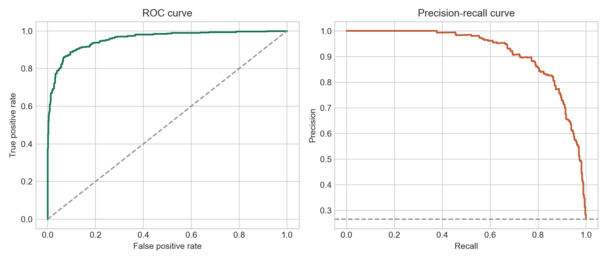
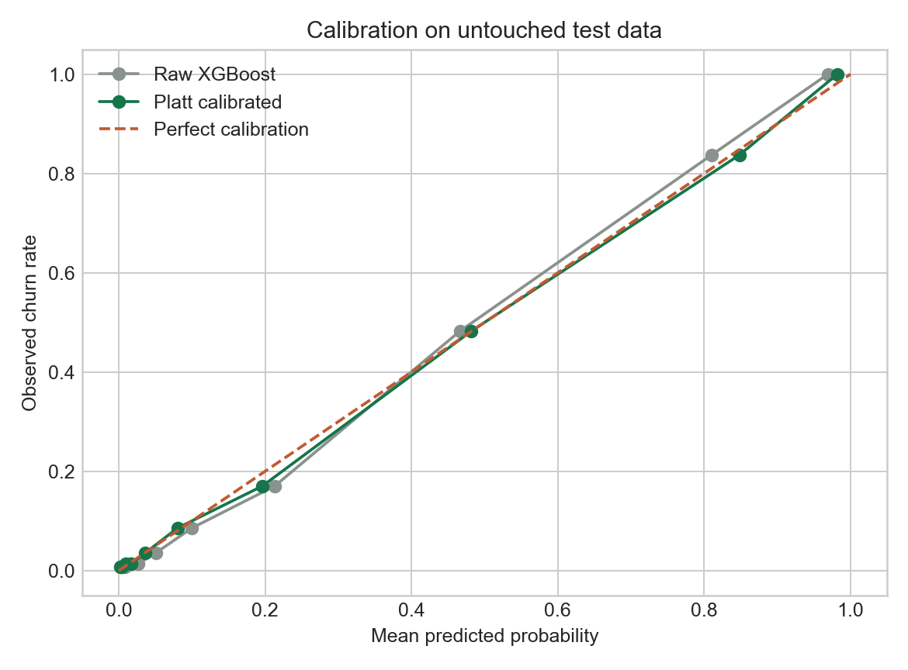
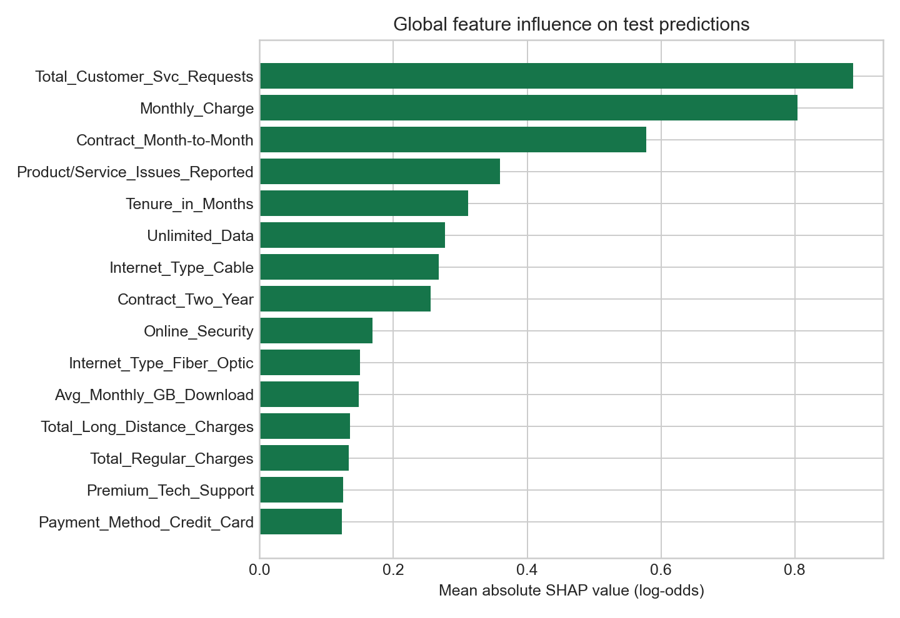
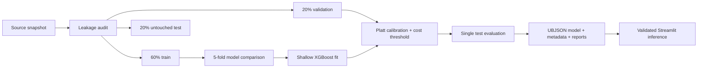
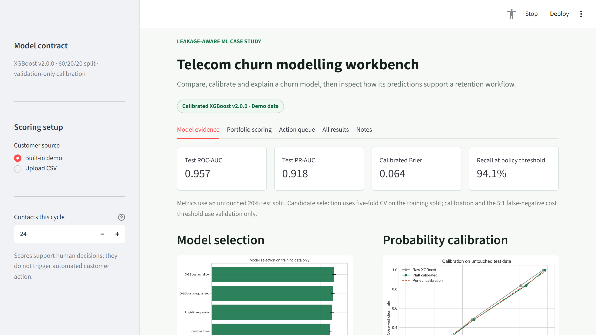

# NZ Telecom Churn ML

[](https://github.com/liyang6620/nz-telecom-churn-ml-simulation/actions/workflows/ci.yml)
[](https://nz-telecom-churn-ml-simulation-8murruu2syd4x2wry5ikcd.streamlit.app/)
[](https://www.python.org/)
[](LICENSE)

An end-to-end binary-classification case study focused on credible model development: leakage
controls, isolated train/validation/test splits, cross-validated model selection, probability
calibration, cost-aware thresholding, SHAP interpretation, reproducible artifacts, and tested
inference. A Streamlit application demonstrates how the model can support a retention workflow;
it is deliberately downstream of the ML evidence.

**[Inspect the live model workbench](https://nz-telecom-churn-ml-simulation-8murruu2syd4x2wry5ikcd.streamlit.app/)**


## ML question

Can signals available before a retention decision rank likely churners, produce useful probability
estimates, and support a recall-oriented intervention policy without using post-outcome fields?

This repository answers that question with a fixed three-way split:

| Partition | Rows | Used for |
|---|---:|---|
| Train | 4,225 (60%) | Five-fold model comparison and final estimator fit |
| Validation | 1,409 (20%) | Platt calibration and threshold selection only |
| Test | 1,409 (20%) | One final, untouched performance estimate |

The split is stratified, seeded, persisted by customer ID, and regenerated by
`python scripts/train_model.py`.

## Results

Four predeclared candidates are compared using five-fold stratified cross-validation on the
training partition only.

| Candidate | CV ROC-AUC | CV PR-AUC | CV Brier |
|---|---:|---:|---:|
| **XGBoost (shallow)** | **0.9504 +/- 0.0061** | **0.9055 +/- 0.0109** | **0.0695** |
| XGBoost (regularised) | 0.9460 +/- 0.0066 | 0.8974 +/- 0.0102 | 0.0734 |
| Logistic regression | 0.9435 +/- 0.0064 | 0.8930 +/- 0.0104 | 0.0894 |
| Random forest | 0.9366 +/- 0.0041 | 0.8782 +/- 0.0101 | 0.0910 |

The selected shallow XGBoost model is fitted on train, calibrated on validation, and evaluated
once on test.

| Untouched test measure | Result |
|---|---:|
| ROC-AUC | **0.9574** (95% bootstrap CI 0.9452-0.9682) |
| PR-AUC | **0.9181** (95% bootstrap CI 0.8958-0.9382) |
| Calibrated Brier score | **0.0645** |
| Log loss | **0.2188** |
| Recall at policy threshold | **94.1%** |
| Precision at policy threshold | **61.2%** |
| F2 at policy threshold | **0.8498** |

The policy threshold (`0.1049`) is selected on validation by assigning false negatives five times
the cost of false positives. It is a transparent demonstration assumption, not a universal
business optimum. Both ranking metrics and threshold metrics are reported because high ROC-AUC
alone does not define an intervention policy.



## Calibration and interpretation

Platt scaling is fitted only on validation. It improves test Brier score from `0.0649` to `0.0645`.
The improvement is modest, which is reported rather than overstated.



Global feature influence is calculated from native XGBoost SHAP contributions on the untouched
test set. Service requests, monthly charge, month-to-month contracts, reported issues, and tenure
are the strongest drivers. SHAP explains model behaviour; it does not establish causality.



## Leakage audit

| Field or group | Decision | Reason |
|---|---|---|
| `Churn Value` | Target only | Outcome label |
| `Churn Category`, `Churn Reason` | Excluded | Known only after churn |
| `Customer Satisfaction` | Excluded | 74% missing and collection timing is ambiguous |
| `Customer ID` | Split tracking only | Identifier, not a generalisable predictor |
| Demographic and location fields | Excluded | Not required; reduces avoidable bias exposure |
| `CLTV` | Excluded | Derived business value is not needed to predict churn propensity |

Service requests and issue counts are retained under the explicit assumption that their snapshot
precedes the prediction point. A real deployment must enforce that point-in-time join contract.

## Reproducible pipeline



The training command regenerates the model, calibrator, schema, split manifest, metrics tables,
SHAP table, and every evaluation figure:

```bash
python -m venv .venv
# Windows: .venv\Scripts\activate
# macOS/Linux: source .venv/bin/activate
python -m pip install -r requirements-notebook.txt
python scripts/train_model.py
```

Machine-readable evidence lives in [`artifacts/model_metadata.json`](artifacts/model_metadata.json).
CSV results under `reports/tables/` make the published numbers independently inspectable.

## Inference and demo

The app loads the XGBoost UBJSON artifact, applies the persisted feature schema and Platt
calibrator, then displays model evidence before portfolio scoring. Upload validation covers schema,
types, ranges, identifiers, categorical domains, file size, and row count. Batch-independence and
score-regression tests protect the training-serving contract.



The capacity-aware queue, revenue-at-risk estimate, and recommended actions are deterministic
decision rules layered after prediction. They are not presented as learned or causal outputs.

## Development checks

```bash
python -m pip install -r requirements-dev.txt
ruff check app.py src scripts tests
python -m compileall -q app.py src scripts tests
pytest -q
```

CI runs code quality and inference tests, rebuilds the complete ML pipeline from source data, and
executes both notebooks in a clean Python 3.12 environment.

## Repository map

```text
.
|-- src/churn_app/
|   |-- training.py               # Split, CV, calibration, evaluation, SHAP, artifacts
|   |-- scoring.py                # Validation and training-serving feature contract
|   |-- calibration.py            # Persisted Platt probability mapping
|   `-- decisions.py              # Explicit post-model business rules
|-- scripts/train_model.py        # One-command reproducible training entry point
|-- artifacts/                    # Metadata and persisted split assignment
|-- reports/                      # Generated figures and inspectable CSV evidence
|-- tests/                        # Inference, validation, evidence, and UI smoke tests
|-- exploratory_analysis.ipynb
|-- feature_engineering_and_modeling.ipynb
|-- churn_model.ubj               # Portable XGBoost model
|-- probability_calibrator.json    # Portable Platt slope and intercept
|-- training_schema.pkl
`-- app.py                        # Downstream Streamlit demonstration
```

## Scope and limitations

- The public dataset is fictional and does not establish performance on NZ telecom customers.
- Random stratified validation cannot replace out-of-time or external validation.
- Bootstrap intervals quantify test-sample uncertainty, not dataset shift.
- Feature influence is associational; retention actions require controlled experiments.
- No fairness claim is made without representative protected-group data and stakeholder review.
- The public app is an interview demonstration, not a production customer decision system.

See the [model card](docs/MODEL_CARD.md), [changelog](CHANGELOG.md),
[contributing guide](CONTRIBUTING.md), and [security policy](SECURITY.md).

## Status

`v2.0.0` is the ML-first portfolio baseline. Published metrics and figures are generated from the
committed pipeline rather than manually copied from exploratory notebook cells.
