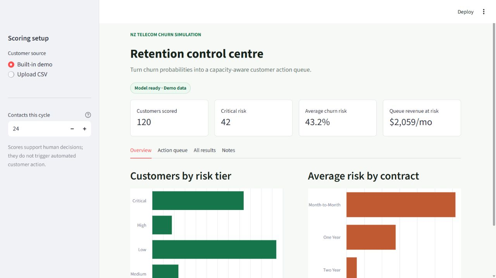
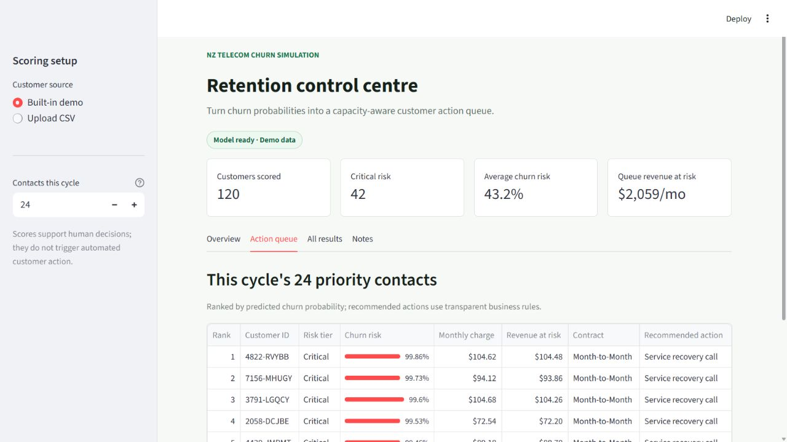
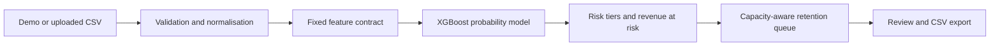

# NZ Telecom Churn Simulation

[](https://github.com/liyang6620/nz-telecom-churn-ml-simulation/actions/workflows/ci.yml)
[](https://nz-telecom-churn-ml-simulation-8murruu2syd4x2wry5ikcd.streamlit.app/)
[](https://www.python.org/)
[](LICENSE)

An interview-ready decision-support demo that turns customer churn probabilities into a
capacity-aware retention queue. It combines a reproducible XGBoost workflow with guarded CSV
ingestion, transparent business rules, revenue-at-risk estimates, and downloadable CRM output.

**[Open the live demo](https://nz-telecom-churn-ml-simulation-8murruu2syd4x2wry5ikcd.streamlit.app/)**
No upload is required: the app opens with 120 fictional demo customers.



## Product workflow

1. Start with the built-in portfolio or upload a compatible UTF-8 customer snapshot.
2. Validate schema, identifiers, numeric ranges, categorical values, file size, and row count.
3. Apply the persisted training schema and generate a churn probability for each customer.
4. Set the team's contact capacity for the current retention cycle.
5. Review the ranked queue, transparent recommended action, and monthly revenue at risk.
6. Download the full plan for downstream CRM or analyst review.



## Why this is more than a model notebook

| Capability | Implementation |
|---|---|
| Immediate evaluation | Built-in representative demo dataset; no setup or upload required |
| Operational decision | Contact capacity converts model scores into a bounded action queue |
| Explainable action layer | Deterministic service-recovery, contract, bundle, and loyalty rules |
| Data quality protection | Actionable validation for missing columns, duplicate IDs, types, and domains |
| Stable inference | Fixed training schema and batch-independent categorical encoding |
| Portable model | XGBoost's stable UBJSON format instead of a version-fragile model pickle |
| Quality controls | Ruff, pytest, Streamlit smoke test, score regression test, notebook execution |
| Responsible use | Explicit limitations, human-review requirement, and no real customer data |

## Architecture



The model probability remains separate from the decision layer. Risk tiers, estimated revenue at
risk, and recommended actions are deterministic rules and are labelled as such in the interface.

## Evaluation snapshot

The reproducible modelling notebook uses a stratified 75/25 train-test split with a fixed random
seed and removes the known outcome/leakage fields before training.

| Hold-out measure | Result |
|---|---:|
| Test ROC-AUC | 0.9755 |
| Overall churn rate | 26.52% |
| Churn rate in top risk decile | 99.44% |
| Top-decile lift | 3.75x |
| Churn rate in top two deciles | 96.32% |
| Top-two-decile lift | 3.63x |

These are portfolio demonstration results from one fictional public dataset, not evidence of
performance on a live New Zealand telecom population. See the [model card](docs/MODEL_CARD.md) for
intended use, limitations, and production monitoring requirements.

## Local setup

```bash
python -m venv .venv
# Windows: .venv\Scripts\activate
# macOS/Linux: source .venv/bin/activate
python -m pip install -r requirements.txt
streamlit run app.py
```

The app will be available at `http://localhost:8501`. Use the built-in demo or switch to
**Upload CSV** and download the input template from the sidebar.

## Development checks

```bash
python -m pip install -r requirements-dev.txt
ruff check app.py src tests
python -m compileall -q app.py src tests
pytest -q
```

CI runs those checks and independently executes both notebooks from a clean checkout. The score
regression test locks the published demo predictions, while the batch-independence test prevents
categorical encoding drift between single-customer and multi-customer uploads.

## Repository structure

```text
.
|-- app.py                              # Streamlit product interface
|-- src/churn_app/
|   |-- config.py                       # Paths, limits, and feature contract
|   |-- scoring.py                      # Validation, preprocessing, inference
|   `-- decisions.py                    # Risk tiers and retention rules
|-- tests/                              # Unit, regression, and app smoke tests
|-- data/
|   |-- telco_test_sample.csv           # 120-row fictional demo input
|   |-- scored_customers.csv            # Regression baseline
|   `-- telco_churn_data.csv             # Source analysis dataset
|-- exploratory_analysis.ipynb
|-- feature_engineering_and_modeling.ipynb
|-- churn_model.ubj                     # Portable XGBoost model artifact
|-- training_schema.pkl                 # Encoded feature ordering
`-- raw_feature_list.pkl                # Raw model input contract
```

## Data, privacy, and scope

- **Dataset:** [JB-Link Telco Customer Churn](https://www.kaggle.com/datasets/johnflag/jb-link-telco-customer-churn)
- **Nature:** public, fictional telecom CRM data used as a portfolio proxy
- **Privacy:** no real New Zealand customer or personally identifying data is used
- **Decision scope:** prioritisation support only; no automated outreach, eligibility, or pricing
- **Demo limits:** UTF-8 CSV, 10 MB, 50,000 rows, and the documented training categories

For a real deployment, the model would require representative local data, time-based validation,
probability calibration, fairness review, drift monitoring, authenticated access, audit logging,
and controlled CRM integration.

## Documentation

- [Model card](docs/MODEL_CARD.md)
- [Changelog](CHANGELOG.md)
- [Contributing](CONTRIBUTING.md)
- [Security policy](SECURITY.md)
- [License](LICENSE) and [third-party notice](NOTICE)

## Status

`v1.0.0` is the intended stable portfolio baseline. The project is maintained as a public
interview demonstration, not as a production telecom service.
